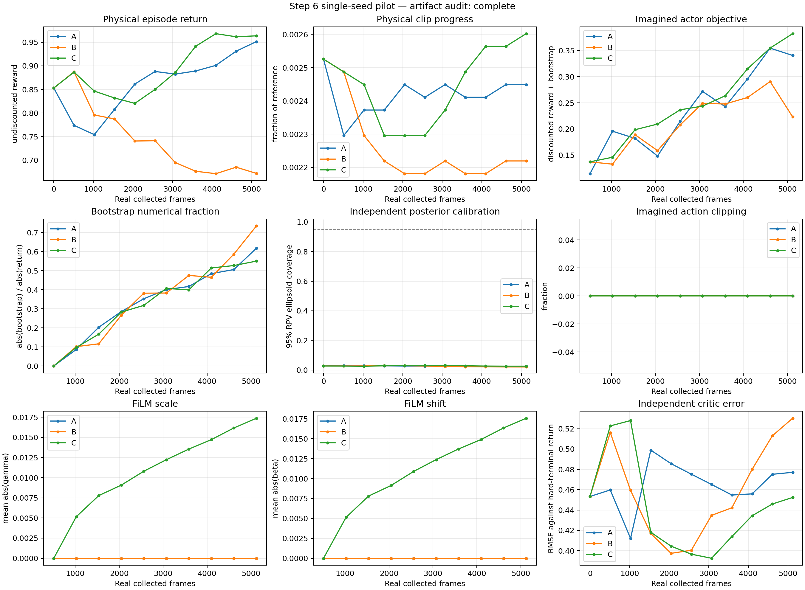

# Step 6：单 seed 预算、恢复与性能验收

`run_eit_pilot` 使用真实 walking motion，在固定训练 seed 下依次运行 A/B/C。
三组显式加载同一个 B 组生成的 v3 初始化包。默认网络宽度、8 环境、64 步采集、
buffer 128、10 × 2048 个 8 帧均值窗口、covariance batch 256/epoch 1，
以及策略 N=4、K=2、H=4、microbatch=2、每轮一次 actor 更新和两次 critic 更新，
均写入 `protocol.json`。已有目录的协议不一致时拒绝继续。

```bash
OMP_NUM_THREADS=1 MKL_NUM_THREADS=1 .venv/bin/python -m supermimic.scripts.run_eit_pilot \
  --motion-file data/motions/walk1_subject1.npz \
  --output artifacts/step6/pilot_verified --seed 2026 --device cuda:0 --online-device cpu
```

可以分开执行 `--phase train` 和 `--phase evaluate`。重复命令从已完成轮次继续，
验证集复用 Step 5 的摘要校验和任务缓存。任何子命令失败都会写入 `status.json`
并返回非零；具体命令、耗时和退出码保存在 `commands.jsonl`，完整输出在 `commands/`。
大体积快照、逐 episode 记录、图和日志位于本地忽略的 `artifacts/`。

若已有第 0 轮 checkpoint，重试会从它恢复。若第 5 或第 10 轮刚写完 checkpoint 就中断，
重试会先核对并补齐该轮的快照、索引和指标。未完整写出的 profiling 行会单独保存；
无法还原的保存后计时在报告中列为缺失。
旧目录若只有第 5 轮快照，审计会提示缺少现场参照。复核恢复需要在新目录重新训练。

## 预算和恢复

训练先运行五轮，使用第 5 轮不可变快照检查恢复，再在新进程恢复至第 10 轮。
每组实采帧数为 5,120，均值更新 100 次、actor 更新 10 次、critic 更新 20 次。
均值窗口允许重复抽样，实际抽取 204,800 个窗口，不能把它解释成相互独立的样本。
covariance 遍历全部有效训练一步对，每轮更新数为 epochs × ⌈pairs / batch size⌉；
失败次数、replay 留存和恢复时清空 replay 会改变有效对数，因此三组的 covariance
实际更新数可以不同。

`metrics.jsonl` 的 `budget` 记录当轮可用及抽取窗口、训练/验证一步对、四类更新增量、
物理终止频率、重建前缀长度和策略 N/K/H。`imagined_steps` 是按 clip 剩余动作截短后
实际计算的想象步数；`survival_weighted_imagined_steps` 是各步进入时 soft survival
权重之和，不含折扣。两者均不是实采帧数。

固定输入验收以第 5 轮训练进程内的模型和优化器为基准。训练进程记录同一批固定输入下
下一次 actor、critic、均值和 covariance 更新的预期结果。验证进程再加载该轮快照，
重放输入并逐位比较。验收用的更新单独保存，真正的续训从第 5 轮快照开始并重新采集物理轨迹。
训练和恢复验证进程在导入 PyTorch 前设置 `PYTORCH_JIT=0`，CUDA 同时使用
`CUBLAS_WORKSPACE_CONFIG=:4096:8`。固定更新使用确定性算子。两侧均在隔离副本上
用相同输入做一次策略预热，丢弃副本后比较下一次更新。网络、采样和更新预算沿用原协议。
数值设置写入 `protocol.json` 和恢复工件，预热及验收开销在 profiling 中单列。

```bash
OMP_NUM_THREADS=1 PYTORCH_JIT=0 CUBLAS_WORKSPACE_CONFIG=:4096:8 \
  .venv/bin/python -m supermimic.scripts.check_eit_resume \
  --checkpoint artifacts/step6/pilot_verified/B/snapshots/frames_2560.pt \
  --reference artifacts/step6/pilot_verified/resume/B-reference.pt \
  --motion-file data/motions/walk1_subject1.npz --device cuda:0 \
  --output artifacts/step6/pilot_verified/resume/B.json
```

## 独立评分

验证 seed 为 17031，每个候选两条从片头开始的首 episode，使用整段协议且无外部步数
预算。每组的第 0 轮和全部十个训练快照都进入验证；测试 seed 17032 只写入冻结清单，
本阶段不读取测试结果。独立诊断使用 seed 4795，逐帧记录和完整 Monte Carlo critic
误差位于 `diagnostics/<group>/<frames>/`。均值/过程噪声与后验的跨模型比较使用同一条
固定物理记录，A 的真值 actor 输入另行评分。

```bash
.venv/bin/python -m supermimic.scripts.report_eit_pilot --pilot artifacts/step6/pilot_verified
```

汇总在 `PILOT/report/` 生成 `report.json`、`learning_curves.png` 和 `learning_curves.pdf`，核对预算、
快照身份、恢复、逐候选验证、独立评分与在线测量。缺少数据为 `pending`，身份或预算
冲突为 `failed`；图中的缺值保持为空。真实回报来自独立验证，训练想象回报来自 replay
采样起点，两条曲线的差值不能直接解释成模型偏差；模型误差需看固定输入诊断。

审计会从原始 episode 重算候选成绩，分别核对初始快照和训练快照的完整名单。
它也从在线逐帧样本重算两个 pass 的统计量，核对设备、motion 文件、线程和 checkpoint。
缺字段、结构损坏或含非有限值的诊断会在下次评估时重新计算。

`diagnose_eit --actor-gradients` 在记录的固定片头及固定噪声上，按 checkpoint 的
H/K/microbatch、soft survival 和 V 上限分别计算奖励项与 bootstrap 项的 actor 梯度。
报告范数、夹角和噪声摘要，零梯度时夹角为 null，不改变优化器或 RNG。
`Policy/bootstrap_fraction` 仍表示回报的数值比例，不能替代梯度比例。

短 walking episode 的校准只能说明失败前的行为。使用其他连续参考补测漂移时，必须
标注来源、时长和状态分布；例如 [Step 5 的 5 s 仰卧固定记录](eit_diagnostics.md#固定后验漂移样例)
仅用于模型/滤波方法诊断，不能作为 walking 长时控制性能。

下面的入口在新目录中生成同款 250 帧 fixture，重新记录真实 MuJoCo 轨迹，并将三组
冻结模型应用于同一份测量与动作。它要求记录连续到片尾，否则保留原始数据并返回失败。

```bash
OMP_NUM_THREADS=1 .venv/bin/python -m supermimic.scripts.record_eit_drift \
  --checkpoint artifacts/step6/pilot_verified/B/snapshots/frames_5120.pt \
  --checkpoints artifacts/step6/pilot_verified/A/snapshots/frames_5120.pt \
    artifacts/step6/pilot_verified/B/snapshots/frames_5120.pt \
    artifacts/step6/pilot_verified/C/snapshots/frames_5120.pt \
  --output artifacts/step6/pilot_verified/drift --device cuda:0
```

`drift/report.json` 并列有符号均值偏差、多步 MSE、白化残差均值范数、二阶矩及去均值
covariance 的对角均值，以及逐秒后验误差和覆盖率；完整二阶矩在各组 `*_process.json`。
该证据用于定位问题，不自动推断更换训练目标
或其他方法设计一定有效。

## 时间与显存

`metrics.jsonl` 的 `profiling` 记录物理采集、均值 rollout/更新、残差提取、完整
covariance 拟合、模型验证、完整前缀重建/归一化、策略 rollout/反传及 critic 回归。
CUDA 阶段边界显式同步；每轮记录 dtype、CPU 线程、进程内预热轮数、显存峰值和当前
allocated/reserved。前缀计时包括 actor/critic 输入归一化，不能按策略 N×K×H 推算。

保存后的耗时写入单独 `profiling.jsonl`，包含 checkpoint 保存、物理 reset、快照发布、
指标写入及完整轮次。这样不需要为补写保存时间而再次改写 checkpoint，保持
`last_metrics` 和 `metrics.jsonl` 的恢复一致性。`runtime_after_save` 另含保存深拷贝的峰值。

```bash
OMP_NUM_THREADS=1 MKL_NUM_THREADS=1 .venv/bin/python -m supermimic.scripts.benchmark_eit_online \
  --checkpoint artifacts/step6/pilot_verified/C/snapshots/frames_5120.pt \
  --motion-file data/motions/walk1_subject1.npz --device cpu \
  --warmup 10 --samples 100 --cpu-threads 1 \
  --output artifacts/step6/online_recheck/C.json
```

在线 benchmark 用 batch=1 的真实闭环观测，关闭离线诊断。一个 pass 不插入分阶段
计时，测量完整 `advance + act` 控制路径；另一个 pass 测量测量/历史、完整滤波/Jacobian、特征、actor 和
限幅。后者额外的 CUDA 同步会增加开销，不能替代前者的端到端延迟。
`filter_and_jacobian` 包含 provider 的版本核验；`clamp_and_commit` 还包括后验提交、
模型内容指纹核验与输出复制，不能把该阶段耗时全部归因于动作限幅。
各项给出均值、p95、p99、20 ms 余量和超期比例，并分开连续滤波帧与 reset prior 帧。
模型构建后的首次显式评估 reset、adapter reset 和首次动作单列。这里的 CPU 指本机主机，GPU 指本机
RTX 5090；未经目标机器人设备实测，不能据此宣称已满足部署周期。

在线测量在预热前释放反序列化的训练 checkpoint 及其优化器张量。显存统计来自
PyTorch 分配器，包括仍在使用的推理模型和仿真张量；Warp 和 MuJoCo 自行分配的显存需另行测量。

## 本机验收与预算决定

复验目录 `artifacts/step6/pilot_verified/` 的最终审计为 `complete`，缺项和失败项均为空。
RTX 5090 上 A/B/C 各训练 10 轮、采集 5,120 帧。三组均通过第 5 轮预热后的逐位恢复检查。
33 个快照共完成 66 条未截断的验证轨迹，全部以物理失败结束。最终快照的平均长度为
32 / 31.5 / 33 步，单线程 CPU 连续滤波帧的在线均值为 50.75 / 49.98 / 51.53 ms。
代码回归为 949 项通过、5 项跳过。[复验记录](validation/eit_step6_recheck.json)

下表与[原始试验摘要](validation/eit_step6_pilot.json)对应 `artifacts/step6/pilot/`，
是锁定正式预算时的实测数据。原始恢复检查从磁盘加载了两次，只证明两次加载结果相同。
该次 GPU 在线显存也包含训练 checkpoint 和优化器。
使用同一 A 组快照，修复后的 GPU 在线测量将 PyTorch 已分配显存从 310.4 MiB 降至
142.1 MiB。错设备、篡改延迟统计和缺失候选的实际注入结果见[审查复验记录](validation/eit_step6_recheck.json)。
三组各完成 10 轮；33 个快照的 66 条验证 episode 均因 `anchor_pos`
物理失败结束，没有预算截断。三组最后快照的平均长度仅为 32 / 29 / 34 步。
独立后验覆盖率明显低于名义 95%，共同 walking 记录同时显示均值偏差与过大的白化残差
二阶矩。250 帧仰卧记录也完整保留，但只作为另一状态分布上的方法诊断。

| 本机测量（A / B / C） | 结果 |
| --- | --- |
| RTX 5090 平均完整训练轮次 | 20.90 / 21.11 / 21.23 s |
| Ryzen 9950X，单线程完整在线均值 | 49.81 / 50.08 / 50.71 ms |
| 同上，p99 | 50.70 / 51.50 / 51.72 ms |
| RTX 5090，完整在线均值 | 60.04 / 60.10 / 60.99 ms |
| 同上，p99 | 62.45 / 63.19 / 64.60 ms |

在线值取不插入分阶段计时的连续滤波帧，预热 10 步、测量 100 步，reset 子集另存。
GPU 在线对照位于 `online_gpu/`，CPU 数据位于 `online/`。两个设备均未达到 20 ms；
没有测量机器人目标设备。原始试验时的代码回归为 569 项通过、5 项跳过，Ruff 通过；默认 Pyright
在所检新增模块中仍报告 18 项 PyTorch/MuJoCo 依赖类型声明问题，未关闭检查规则。

[正式统一预算](validation/eit_step6_budget.json) 已锁定为新 seed
2027–2031，每组 100 轮、51,200 实采帧，统一在第 50 轮恢复一次。保留本次网络、
采样规则和 H=4，每 10 轮评估一次预先列出的候选，测试结果在验证选模封存后读取。
这是相对 pilot 增加十倍的数据和更新预算；固定片头的 bootstrap 梯度未主导奖励梯度，
目前没有据此增大 H。该观察不保证其他起点也有相同的梯度比例。

15 条训练线的纯训练估计约 8.78 h，全部轮次存档及当前 checkpoint 约 248.5 GiB，
建议预留 260–300 GiB。本次复验的第 5 轮现场参照占 174.6–178.6 MiB/组，
按 15 条训练线各保留一份估计，另需约 2.6 GiB。纯训练时间不包含启动、恢复验收、独立评估、诊断和备份；若控制开始
完成长 clip，评估成本会明显上升。Step 7 尚未运行。工程流程通过不等于控制方法有效，
也不证明训练已经收敛或满足实时部署要求。



[矢量 PDF](validation/eit_step6_learning_curves.pdf)
